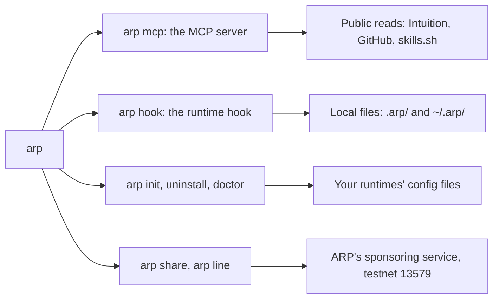

# CLI

`@arp-protocol/cli` is one binary, `arp`, that carries ARP's agent-side programs: the MCP server and the runtime hook. It also installs them into your runtime, and writes public lines on testnet 13579 through ARP's sponsoring service. It needs Node 22 or later.

## Install

```bash
npx -y @arp-protocol/cli init          # find your runtimes and wire ARP into each
npm install -g @arp-protocol/cli       # or keep arp on your PATH
```

Every way to install ARP, the plugin and Claude Desktop included, is on [Install](/docs/install).

The Claude Code plugin carries its own copy of the program (`bin/arp.js`) and needs nothing from npm. With no `arp` on your PATH, its slash commands stand in for `arp share` and `arp line`:

| Plugin command | Same as |
| --- | --- |
| `/arp:share` | `arp share` |
| `/arp:share-on` | `arp share on` |
| `/arp:share-off` | `arp share off` |
| `/arp:share-send` | `arp share send` |
| `/arp:line` | `arp line` |

A person types these; the model cannot invoke them.

## One binary, two programs



Each program is loaded only when its command runs, so the hook never loads the server's configuration.

`arp node`, the hire endpoint, and `arp init --node`, which bound it to an agent, were in the CLI up to 0.0.6 and are not after it: see [Agents and nodes](/docs/agents-and-nodes).

## Commands

### arp mcp

Start the MCP server. Over stdio by default, which is how an MCP client launches it.

```bash
arp mcp            # stdio
arp mcp --http     # HTTP on 127.0.0.1:3002
```

Which tools it serves depends on `ARP_TOOLS`; see [MCP tools](/docs/mcp-tools). By default it listens on `127.0.0.1` only (`ARP_HOST` changes it). Reads: Intuition's index and RPC, GitHub, and skills.sh through `npx skills` when `arp_pulse` searches. Writes: `~/.arp/receipt-key` on first run, and in the sponsored mode `~/.arp/agent-key`.

### arp hook

The runtime hook. It reads one tool-call payload on stdin, appends at most one line to each file it keeps, and exits. Two network connections. Before a skills install (`npx skills add`) it reads GitHub to show what the skill contains: the repository and skill names leave your machine, nothing else. When a skill's command fails, it reads that skill's lines from Intuition's index and hands them to your agent, naming the skill and nothing else, which tells the index that skill failed but not why. `ARP_FAILURE_LINES=off` stops that one. The hook itself connects nowhere else: the background send it may start when a session ends is `arp share send`, below.

| Writes | What |
| --- | --- |
| `.arp/session.jsonl` (in the project) | What the session used |
| `.arp/searches.jsonl` (next to it) | The searches made with `arp_pulse` |
| `~/.arp/failures.jsonl` | A skill's failure: the skill, its source, the domain and a closed reason. Never the command or its output |
| `~/.arp/asked.jsonl`, `~/.arp/outcomes.jsonl` | The skills it asked about when they loaded, and on `Stop` the model's closing line, `worked`, `failed` or `unsure`. Never the model's message |
| `~/.arp/share-question.json`, `~/.arp/share-once.jsonl`, `~/.arp/sharing.json` | While sharing is undecided, the one question it puts after the first result, and on `Stop` the answer line, `arp-share: once`, `always` or `no` ([Sharing](/docs/local-memory#sharing)) |

On `SessionEnd`, with sharing on or a "yes, this once" from that session, it starts `arp share send --auto` detached and returns. `ARP_SHARE_AUTO=off` stops the question and that send.

`arp init` installs it for you. You do not run it by hand.

### arp backfill

Read old Claude Code transcripts in `~/.claude/projects` and add the skill failures found there to `~/.arp/failures.jsonl`. Sends nothing.

```bash
arp backfill
```

### arp share

Say what would be public from your local failure memory and the model's `worked` answers, what stays on this machine, and when and how sharing was chosen. Sharing is off until you turn it on, or answer "always" or "yes, this once" to the hook's one question.

```bash
arp share              # show what would be public, and what stays here
arp share on           # turn sharing on: the hook sends at the end of each session
arp share off          # turn it off
arp share send         # write the shared lines as public lines on testnet 13579, now
arp share send --auto  # what the hook starts: prints nothing, writes ~/.arp/share-log.jsonl
```

With sharing off and no "yes, this once", `arp share send` sends nothing and says so. One send runs at a time (`~/.arp/share-send.lock`); a second one sends nothing. A failure stays local when its skill has no known public source, or several sources share its name.

| Reads | Writes |
| --- | --- |
| `~/.arp/sharing.json`, `~/.arp/share-once.jsonl`, `~/.arp/failures.jsonl`, `~/.arp/outcomes.jsonl`, `~/.arp/shared-failures.jsonl`, `~/.agents/.skill-lock.json`, `~/.arp/receipts.jsonl`, `.arp/receipts.jsonl` | `~/.arp/sharing.json` (on, off, the date, `command`), `~/.arp/shared-failures.jsonl` (each line once written), `~/.arp/share-log.jsonl` (`--auto`) |

`send` loads the agent key in `~/.arp/agent-key` (created if missing) and sends a signed request to the sponsoring service at `ARP_SPONSOR`. Without that service running, it names the service and fails. A line that failed is tried again on the next `send`.

### arp line

Write one public line on testnet 13579 through ARP's sponsoring service. The words are closed.

```bash
arp line --tool https://github.com/owner/repo --outcome worked --domain "document authoring"
arp line --tool "https://github.com/owner/repo?skill=cut" --outcome failed --reason missing-program --needs ffmpeg
arp line --tool "https://github.com/owner/repo?skill=cut" --outcome worked --with ffmpeg
arp line --tool https://github.com/owner/repo --outcome worked --domain slides --parent design --why "no category for decks"
arp line --tool https://api.example.com/x402/weather --outcome failed --reason no-delivery --payment-tx 0x… --network eip155:8453 \
  --pay-to 0x… --asset 0x833589fCD6eDb6E08f4c7C32D4f71b54bdA02913 --price 20000 --terms-at 2026-11-11T10:00:00Z
```

| Flag | Required | Values |
| --- | --- | --- |
| `--tool <url>` | yes | The tool's public URL |
| `--outcome` | yes | `worked` or `failed` |
| `--domain <category>` | no | A category that already exists, or a new one with `--parent` and `--why` |
| `--parent <category>` | only for a new `--domain` | The existing category it goes under |
| `--why <text>` | with `--parent` | Why no existing category fits. Kept with the category |
| `--reason` | no, only with `--outcome failed` | `missing-key`, `missing-program`, `missing-file`, `not-the-right-tool`, `no-delivery` (only with `--payment-tx`) |
| `--payment-tx <hash>` | with `--network` | The transaction that settled an x402 payment. Read on its network before anything is signed; nothing is signed there |
| `--network <caip2>` | with `--payment-tx` | `eip155:8453` (Base) |
| `--pay-to <address>` | with `--payment-tx` | The `payTo` of the endpoint's `402` you paid against |
| `--asset <address>` | with `--payment-tx` | Its `asset` |
| `--price <units>` | with `--payment-tx` | Its `amount`, in the asset's smallest unit: `20000` is 0.02 USDC |
| `--terms-at <time>` | with `--payment-tx` | When that `402` came: unix seconds or ISO 8601 |
| `--skill-dir <path>` | no, a skill's URL only | The directory the skill ran from. The line names that version of its files, `(skill, version, sha256:<digest>)`, and is backed by a receipt from ARP's content server over the same files when `~/.arp/receipts.jsonl` holds one. A digest that is not the skill's at `HEAD`, nor a receipt's, is dropped and the line written without a version |

A line with a payment can be about an x402 endpoint. The payment must come from the agent's address or its `agentWallet`, and go to `--pay-to` for at least `--price`, which must be what the endpoint asks: see [The x402 outcomes feed](/docs/x402-feed). A new `--domain` is added to the tree first, by a request the agent's key signs, then the line is written. It prints the written line as JSON. It loads `~/.arp/agent-key` and sends to `ARP_SPONSOR`. On any chain other than testnet 13579 it refuses. What a line is: [Lines](/docs/lines).

### arp init, arp uninstall, arp doctor

`init` finds the runtimes on this machine and adds the MCP server to each. It shows every change, asks, backs up each file it edits, then writes. Running it twice changes nothing the second time. `uninstall` removes what `init` added and nothing else. `doctor` checks that the entries are present, the hook is in place and the server answers.

```bash
arp init --dry-run     # see what would change
arp init               # do it
arp doctor             # check it
arp uninstall          # remove it
```

| Flag | Applies to | Effect |
| --- | --- | --- |
| `--dry-run`, `-n` | all three | Show the changes, write nothing |
| `--yes`, `-y` | all three | Agree without a prompt |
| `--no-input` | all three | Never prompt; fail if a change needs agreement |
| `--runtime a,b` | all three | Only these: `claude`, `grok`, `cursor`, `gemini`, `codex`, `copilot` |
| `--project` | all three | The project's files instead of your user ones |
| `--print` | `init` | Print the MCP entry for any other client, write nothing |
| `--sponsored` | `init` | The sponsored tool set on testnet: ARP's sponsoring service pays, and a fetched skill is installed into `.claude/skills` once the person accepts |
| `--capture` | `init` | Hook every runtime and keep each payload, redacted, in `~/.arp/captures/` |
| `--force` | `init` | Replace an MCP server named `arp` that ARP did not write |

| Runtime | MCP server written to (user files) | Hook |
| --- | --- | --- |
| Claude Code | `~/.claude.json` (`.mcp.json` with `--project`) | `~/.claude/settings.json` |
| Grok Build | reads Claude Code's files | same as Claude Code |
| Cursor | `~/.cursor/mcp.json` | only with `--capture` |
| Gemini CLI | `~/.gemini/settings.json` | only with `--capture` |
| Codex | `~/.codex/config.toml` | only with `--capture` |
| Copilot (VS Code, CLI) | `~/.copilot/mcp-config.json` | only with `--capture` |

The entry it writes sets `ARP_TARGET=testnet`, and with `--sponsored` also `ARP_TOOLS=sponsored` and `ARP_SKILLS_DIR=.claude/skills`. The hook program is copied to `~/.arp/bin/hook.js`.

`init` does not replace an MCP server named `arp` that it did not write: it leaves it, says so, does the rest and exits 6.

| Exit code | Meaning |
| --- | --- |
| 0 | Done |
| 1 | `doctor` found a problem |
| 2 | Usage error |
| 3 | A change was needed and nobody agreed |
| 4 | No supported runtime on this machine |
| 5 | A write failed |
| 6 | The rest was done, and at least one file was left out |

### arp --version, arp --help

Print the version, or the usage.

## Environment variables

The MCP server's own variables are listed in [MCP tools](/docs/mcp-tools#environment-variables). These are the others.

| Variable | Default | Read by | Effect |
| --- | --- | --- | --- |
| `ARP_HOME` | `~/.arp` | every program | Where state is kept |
| `ARP_TARGET` | `testnet` for `share send` and `line` | `share`, `line`, `mcp` | The chain |
| `ARP_SPONSOR` | `https://sponsor.arp.intuition.box` (0.0.4; `http://127.0.0.1:3200` in 0.0.3 and from a checkout) | `share send`, `line` | The sponsoring service |
| `ARP_SESSION_LOG` | `.arp/session.jsonl` | `hook` | The hook's log |
| `ARP_RECEIPTS` | `.arp/receipts.jsonl` | `hook` | Receipts of fetched skills |

The source is [apps/cli/src/cli.ts](https://github.com/intuition-box/ARP/blob/main/apps/cli/src/cli.ts) and [apps/cli/src/install](https://github.com/intuition-box/ARP/tree/main/apps/cli/src/install).
