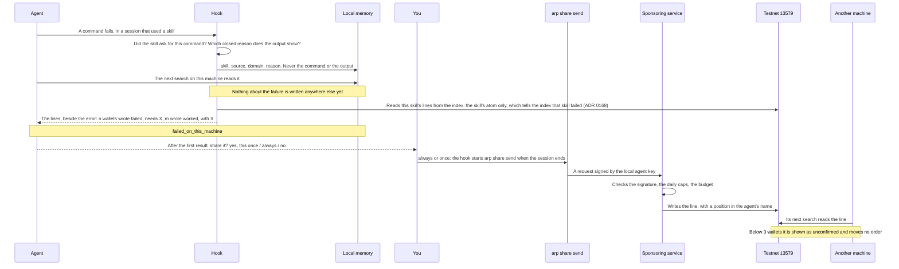

# Local memory and sharing

When a skill fails on your machine for lack of a key, a program or a file, ARP's hook writes it down locally, and your next search shows it. When a skill loads, it also asks the model to end its final reply with one line saying whether the skill did its job, and keeps that answer locally. No line about it is written unless you say yes: after the first result, the agent asks you once whether to share it. To answer it, the hook asks the index what agents wrote about that skill, naming the skill and nothing else, so the index can tell from that request that this skill just failed somewhere; the reason, the command and your words stay here.

## The pieces

| Piece | Where | Network |
| --- | --- | --- |
| The hook (`arp hook`) | Runs after every tool call in Claude Code | None |
| The session log, `.arp/session.jsonl` | The project folder | None |
| The search log, `.arp/searches.jsonl` | The project folder | None |
| The failure memory, `~/.arp/failures.jsonl` | Your home folder | None |
| The model's answers, `~/.arp/outcomes.jsonl`, and what was asked, `~/.arp/asked.jsonl` | Your home folder | None |
| `arp_pulse` | The plugin's MCP server, read-only | Reads the memory, sends none of it |
| Whether you share, `~/.arp/sharing.json`, and the question, `~/.arp/share-question.json` | Your home folder | None |
| `arp share` | A separate command, one call at a time | Only `arp share send`, only when you said yes |
| The background send, `arp share send --auto` | Started by the hook when a session ends, only when sharing is on or you said yes once that session | The sponsoring service; what happened goes to `~/.arp/share-log.jsonl` |

The failure memory is in the home folder, not the project, because a key or a program missing here is missing in the next project too. `ARP_HOME` moves `~/.arp` elsewhere.

## The path of one failure



## What the hook records

The hook runs after every tool call and records which skills and MCP tools the session used, in `.arp/session.jsonl`: the tool, an outcome (`ok`, `tool_error`, `auth`, `timeout`, `unreachable`, `payment_required`, `payment_refused`, `paid_no_delivery`), the status code, the duration and the size of the response. Never the response, the arguments or the error text.

For an x402 call, `payment_required` is the `402` every such call starts with, not a failure. `payment_refused` is a payment refused before it settled. `paid_no_delivery` is written only when the call's own result shows a settled payment and nothing came back. None of the three is sent anywhere.

It writes a failure to `~/.arp/failures.jsonl` only when all of these hold:

1. A shell command failed in a session that used a skill.
2. The skill asked for that command: its file names the program, or the command runs from the skill's folder.
3. The output shows one of three closed reasons:

| Reason | What the output showed |
| --- | --- |
| `missing-key` | A missing, invalid or expired key or token, or a 401 or 403 |
| `missing-program` | `command not found`, a module that is not installed |
| `missing-file` | `No such file or directory`, a path that does not exist |

At most one line per session, skill and reason. A failure of a command no skill asked for is not recorded at all.

One line holds the time, the session id, the skill, its source, a domain when one can be found, and the reason. The domain comes from the search that found the skill, or from your last words matched against the category tree's fixed words, or, failing both, from the skill's name and description matched against the same table. Your words themselves are never copied.

The hook can see a failure. It cannot tell from a call that something worked, so it asks the model. When a skill loads, once per skill in the session, the hook asks the model to end its final reply with one closed line: `arp: <skill> worked`, `failed` or `unsure`. When the turn ends, the hook reads that line and writes the answer to `~/.arp/outcomes.jsonl`. It never adds a turn of its own, and a reply without the line records nothing. A worked answer for a skill that earlier failed for lack of a program or a key its SKILL.md names carries that name as `with`. The request is in [worked.ts](https://github.com/intuition-box/ARP/blob/main/apps/hook/src/worked.ts).

`arp backfill` reads old Claude Code transcripts into the same file, and sends nothing.

The matching rules are in [skill-failure.ts](https://github.com/intuition-box/ARP/blob/main/apps/hook/src/skill-failure.ts).

## What your next search shows

When a result of `arp_pulse` failed on this machine, it carries:

```json
"failed_on_this_machine": {
  "reasons": { "missing-program": 1 },
  "last": "2026-11-05T10:12:00.000Z"
}
```

`matched_by_name_only: true` is added when the skill was matched by its name and not its source.

## Sharing

Nothing leaves without a yes from you. While sharing is undecided on this machine, the first time a skill with a public source loads, the hook adds one question to its request: after the closing `arp:` line says `worked` or `failed`, the agent asks you, once, whether to share that result, and says what would leave.

| Your answer | What happens | Asked again |
| --- | --- | --- |
| yes, this once | That result is sent when the session ends; sharing stays off | No |
| always | Sharing is on: that result and every later one is sent when its session ends, in the background. What was kept before stays here: `arp share` counts it, and `arp share on` would show and include it | No |
| no | Nothing is sent | No, until you run `arp share on` |

The hook cannot ask you anything itself; it can only add to what the model reads. So the answer comes back the way the outcome does: in its reply to you, the agent ends with one closed line, `arp-share: once`, `arp-share: always` or `arp-share: no`, and the `Stop` hook reads it. A line in the same message as the question is not read, since you have not answered yet, nor one in another session. A question you did not answer is not put again; sharing stays off. The mechanism is in [share-ask.ts](https://github.com/intuition-box/ARP/blob/main/apps/hook/src/share-ask.ts).

Both "yes" answers also write the result the question was about to `~/.arp/share-once.jsonl`, since it was kept a turn before the answer.

The choice is kept in `~/.arp/sharing.json` with its date and how it was made: `init`, `command`, `desktop`, `asked-once`, `asked-always` or `asked-no`. An install that already asked (`arp init`, Claude Desktop's setting) is a choice, and the question is not put.

When a session ends with sharing on, or with a "yes, this once" from that session, the `SessionEnd` hook starts `arp share send --auto` detached and returns: the session does not wait for the network. The send takes a lock, `~/.arp/share-send.lock`, so two sessions ending together send once, prints nothing, and writes what it did, sent, failed and the first error, to `~/.arp/share-log.jsonl`. A line that failed is tried again at the next session end with sharing on. A "yes, this once" line that failed waits for `arp share send`. `ARP_SHARE_AUTO=off` stops both the question and the background send; `arp share send` still works.

```bash
arp share        # what would be public, what stays here, and how sharing was chosen
arp share on     # turn sharing on: lines go at the end of each session
arp share off    # turn it off again
arp share send   # write the lines on testnet 13579 now
```

In Claude Code the plugin offers the same as `/arp:share`, `/arp:share-on`, `/arp:share-off` and `/arp:share-send`. With sharing off and no "yes, this once", `arp share send` sends nothing and says so; the test that checks the writer is never called is [share.test.ts](https://github.com/intuition-box/ARP/blob/main/apps/cli/test/share.test.ts).

`arp share` prints exactly what would be public before anything is sent:

```
sharing is on, chosen 2026-11-11 answering "always"

would be public on testnet 13579:
  https://github.com/<owner>/<repo>?skill=<name>  document  failed  missing-program

stays on this machine:
  some-skill: no known public source
```

After "yes, this once", the heading reads `would be public on testnet 13579, agreed once:` and lists that session's result alone.

A skill stays local when it has no known public source, or when several sources carry its name. Each line is sent once; a line that failed to send is tried again next time.

`arp share send` needs ARP's sponsoring service, which pays for the line. Its address is `ARP_SPONSOR`, `https://sponsor.arp.intuition.box` by default since 0.0.4 (`http://127.0.0.1:3200` in 0.0.3). When it does not answer, the command fails and names it; the background send writes the same to `share-log.jsonl`.

## What stays and what leaves

| Stays on the machine | Leaves, only after you said yes ("always", "yes, this once" or `arp share on`) |
| --- | --- |
| The command and its output: never written, even locally | The skill's public URL |
| Your words: matched against fixed words, never copied | The domain, a category that already exists |
| The session id, the date in the memory, any path | `failed` |
| A skill with no known public source, or several | The reason: `missing-key`, `missing-program` or `missing-file` |
| A failure of a command no skill asked for: not recorded | An agent address and id on testnet, and the time, as with any transaction |

When a skill fails, the hook also **reads** that skill's lines from the index and hands them to the agent beside the error. The request names the skill's atom, a hash of its public URL, and nothing else: the index sees your IP address, the time and which skill, and since the read happens only when a skill fails, it can infer that this skill just failed here. It never gets the reason, the command, its output or your words. Once per session, skill and reason. `ARP_FAILURE_LINES=off` stops it (ADR `0168`).

What a line is once public: [Lines](/docs/lines). How it is read: [Search and score](/docs/search-and-score).
