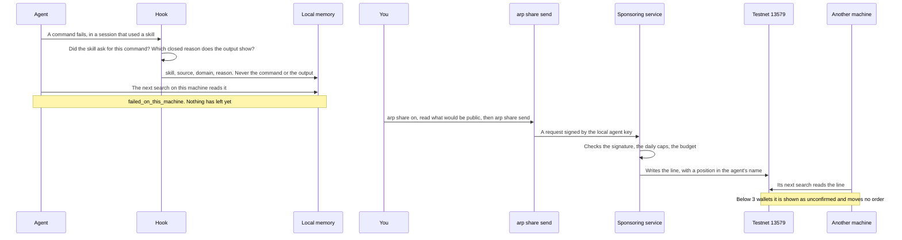

# Local memory and sharing

When a skill fails on your machine for lack of a key, a program or a file, ARP's hook writes it down locally, and your next search shows it. Nothing leaves your machine unless you turn sharing on and send it yourself.

## The pieces

| Piece | Where | Network |
| --- | --- | --- |
| The hook (`arp hook`) | Runs after every tool call in Claude Code | None |
| The session log, `.arp/session.jsonl` | The project folder | None |
| The search log, `.arp/searches.jsonl` | The project folder | None |
| The failure memory, `~/.arp/failures.jsonl` | Your home folder | None |
| `arp_pulse` | The plugin's MCP server, read-only | Reads the memory, sends none of it |
| `arp share` | A separate command, one call at a time | Only `arp share send`, only when sharing is on |

The failure memory is in the home folder, not the project, because a key or a program missing here is missing in the next project too. `ARP_HOME` moves `~/.arp` elsewhere.

## The path of one failure



## What the hook records

The hook runs after every tool call and records which skills and MCP tools the session used, in `.arp/session.jsonl`: the tool, an outcome (`ok`, `tool_error`, `auth`, `timeout`, `unreachable`, `payment`), the status code, the duration and the size of the response. Never the response, the arguments or the error text.

It writes a failure to `~/.arp/failures.jsonl` only when all of these hold:

1. A shell command failed in a session that used a skill.
2. The skill asked for that command: its file names the program, or the command runs from the skill's folder.
3. The output shows one of three closed reasons:

| Reason | What the output showed |
| --- | --- |
| `missing-key` | A missing, invalid or expired key or token, or a 401 or 403 |
| `missing-program` | `command not found`, a module that is not installed |
| `missing-file` | `No such file or directory`, a path that does not exist |

At most one line per session, skill and reason. A failure of a command no skill asked for is not recorded at all.

One line holds the time, the session id, the skill, its source, a domain when one can be found, and the reason. The domain comes from the search that found the skill, or from your last words matched against the category tree's fixed words, or, failing both, from the skill's name and description matched against the same table. Your words themselves are never copied.

The hook can see a failure. It can never tell that something worked, so `worked` never comes from it.

`arp backfill` reads old Claude Code transcripts into the same file, and sends nothing.

The matching rules are in [skill-failure.ts](https://github.com/intuition-box/ARP/blob/main/apps/hook/src/skill-failure.ts).

## What your next search shows

When a result of `arp_pulse` failed on this machine, it carries:

```json
"failed_on_this_machine": {
  "reasons": { "missing-program": 1 },
  "last": "2026-11-05T10:12:00.000Z"
}
```

`matched_by_name_only: true` is added when the skill was matched by its name and not its source.

## Sharing

Sharing is off by default. With it off, `arp share send` sends nothing and says so; the test that checks the writer is never called is [share.test.ts](https://github.com/intuition-box/ARP/blob/main/apps/cli/test/share.test.ts).

```bash
arp share        # what would be public, and what stays here
arp share on     # turn sharing on
arp share off    # turn it off again
arp share send   # write the lines on testnet 13579
```

In Claude Code the plugin offers the same as `/arp:share`, `/arp:share-on`, `/arp:share-off` and `/arp:share-send`.

`arp share` prints exactly what would be public before anything is sent:

```
sharing is on

would be public on testnet 13579:
  https://github.com/<owner>/<repo>?skill=<name>  document  failed  missing-program

stays on this machine:
  some-skill: no known public source
```

A skill stays local when it has no known public source, or when several sources carry its name. Each line is sent once; a line that failed to send is tried again next time.

`arp share send` needs ARP's sponsoring service, which pays for the line. Its address is `ARP_SPONSOR`, `http://127.0.0.1:3200` by default. When it is not running, the command fails and names it.

## What stays and what leaves

| Stays on the machine | Leaves, only after `arp share on` and `arp share send` |
| --- | --- |
| The command and its output: never written, even locally | The skill's public URL |
| Your words: matched against fixed words, never copied | The domain, a category that already exists |
| The session id, the date in the memory, any path | `failed` |
| A skill with no known public source, or several | The reason: `missing-key`, `missing-program` or `missing-file` |
| A failure of a command no skill asked for: not recorded | An agent address and id on testnet, and the time, as with any transaction |

What a line is once public: [Lines](/docs/lines). How it is read: [Search and score](/docs/search-and-score).
