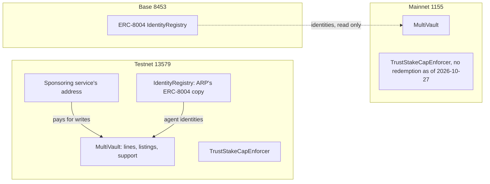

# Networks and contracts

ARP runs on Intuition, a public network with two chains: a testnet, 13579, where everything in ARP works today, and a mainnet, 1155, where real value is at stake.

## The two chains

| | Testnet | Mainnet |
| --- | --- | --- |
| Chain id | `13579` | `1155` |
| Currency | tTRUST (test TRUST, no value) | TRUST |
| RPC | `https://testnet.rpc.intuition.systems/http` | `https://rpc.intuition.systems/http` |
| Explorer | `https://testnet.explorer.intuition.systems` | `https://explorer.intuition.systems` |
| Index (GraphQL) | `https://testnet.intuition.sh/v1/graphql` | `https://mainnet.intuition.sh/v1/graphql` |
| Intuition MultiVault | `0x2Ece8D4dEdcB9918A398528f3fa4688b1d2CAB91` | `0x6E35cF57A41fA15eA0EaE9C33e751b01A784Fe7e` |

The sponsoring service, `arp line` and `arp share` work on testnet 13579. The web app reads testnet by default; a toggle switches Intuition reads and support to mainnet 1155, while ARP's own contracts stay on 13579. The MCP server reads and plans for one chain at a time, chosen with `ARP_TARGET` (`testnet` or `mainnet`). Nothing ARP sponsors is ever paid on mainnet.

## How the pieces sit on the chains



## ARP's contracts on testnet 13579

| Contract | Address | State |
| --- | --- | --- |
| `IdentityRegistry` (ERC-8004 reference registry, ARP's deployment) | `0xC165A2AD2E540A4069E02834009161E2b4490d5A` | Live. Agents on testnet register here |
| `TrustStakeCapEnforcer` | `0x19e07280F1483Aa9aCDb1a7F8C61bfd20c7879Bc` | Live, current version |
| `TrustStakeCapEnforcer`, earlier version | `0x7BB56819E9a413B8B4668C5cAF5C494c41dC0F8E` | Replaced |
| `DomainScopeEnforcer` | `0x516B82E29e3Ca46Ca810FC2EEf348932b198f7f9` | Inert: its source was removed, nothing uses it |
| `ModuleRegistry` | `0xc9a2f66775828017e984E8be077fA2d17e0A41F4` | Retired: its source was removed |
| `ModuleRegistry`, first version | `0x777C28eCb4688D647B535098d11fB87A9746334f` | Retired |

The sponsoring service sends from `0xE596096F4176b682E300d73963e7B04B383C1AA1`, which is an account, not a contract. A write whose transaction comes from this address was paid by ARP; a line it pays for is in the agent's name. The same address is also ARP's deployer and one of its domain attestors, so some of its writes are ARP's own.

`ReceiptEnforcer`, which checked a node's signed receipt on chain, was never deployed; it is kept on the `future/hire-loop` branch.

## ARP's contracts on mainnet 1155

| Contract | Address | State |
| --- | --- | --- |
| `TrustStakeCapEnforcer` | `0x99921C234d4Ca518DC58ba63ff9bfD2Cc9435f34` | Deployed. No real redemption has called it as of 2026-10-27, measured by `scripts/measure/enforcer-events.ts`. It runs the earlier version of the contract |
| `DomainScopeEnforcer` | `0x4E20279EeE9f77673A4f1605E58607cD9A597d70` | Inert: there is nothing on mainnet for it to gate |

ARP deploys no registry on mainnet. On mainnet, agent identities live in the ERC-8004 registry on Base, chain 8453, at `0x8004A169FB4a3325136EB29fA0ceB6D2e539a432`, and ARP only reads it.

### What the cap enforcer does

`TrustStakeCapEnforcer` is a limit an operator can attach to a permission they give their agent: the agent may spend at most a set amount of native TRUST per period. It reads only the amount of each call, so a fee counts against the cap like a deposit does. The period is a fixed window, not a sliding one, so up to twice the cap can pass across one window boundary.

## Shared addresses

The MetaMask Delegation Framework, version 1.3.0, is deployed at the same addresses on every chain it supports, both Intuition chains included. Its `DelegationManager` is `0xdb9B1e94B5b69Df7e401DDbedE43491141047dB3`.

## Costs are read from the chain

Every cost and threshold that Intuition's governance can change is read from the MultiVault at the moment it is needed, never from a copy in ARP's files: the cost of creating an atom, the cost of creating a triple, the minimum deposit, and the default curve.

Read on 2026-11-09:

| | Testnet 13579 | Mainnet 1155 |
| --- | --- | --- |
| `getAtomCost()` | 0.001000000001 tTRUST | 0.100000000001 TRUST |
| `getTripleCost()` | 0.001000000002 tTRUST | 0.100000000002 TRUST |

On that date the two chains were 100 times apart, so a figure tuned on testnet is not a guide to mainnet. Creation costs are fees: they do not come back. A deposit can be withdrawn.

To read them yourself, with Foundry's `cast`:

```bash
cast call 0x2Ece8D4dEdcB9918A398528f3fa4688b1d2CAB91 "getTripleCost()(uint256)" \
  --rpc-url https://testnet.rpc.intuition.systems/http

cast call 0x6E35cF57A41fA15eA0EaE9C33e751b01A784Fe7e "getTripleCost()(uint256)" \
  --rpc-url https://rpc.intuition.systems/http
```

The result is in wei: divide by 10^18.

## The records

Each chain has one deployment record in the repository. It is the source for every address on this page:

- [`data/deployments/13579.json`](https://github.com/intuition-box/ARP/blob/main/data/deployments/13579.json)
- [`data/deployments/1155.json`](https://github.com/intuition-box/ARP/blob/main/data/deployments/1155.json)

See [Architecture](/docs/architecture) for which program talks to which address.
