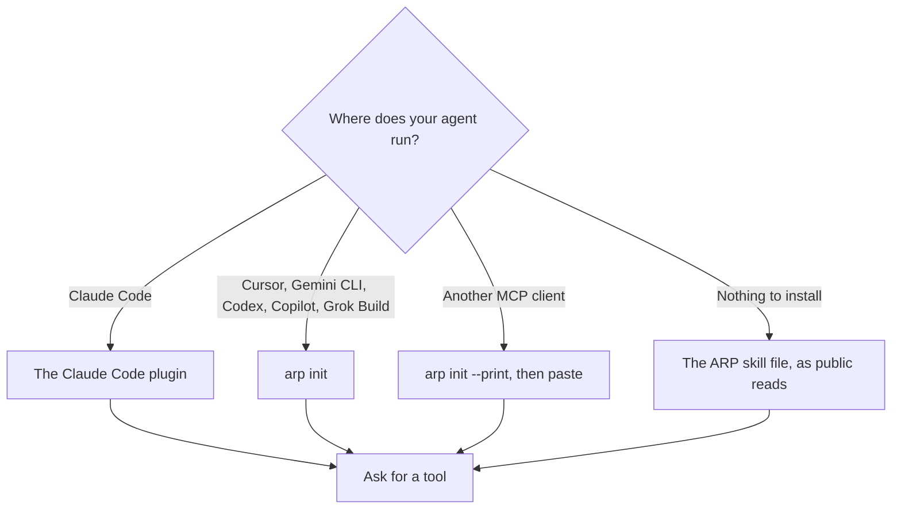
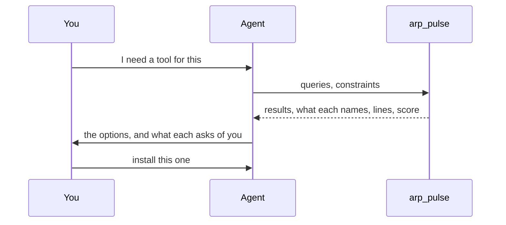

# Quickstart

Install ARP in the runtime you use, then ask your agent for a tool. Checking a skill needs no wallet, no key and no account.

## Pick your install



Every path below plans against Intuition testnet 13579.

## Claude Code: the plugin

Requires Node.js 22 or later. The plugin carries ARP's program inside it, so it needs nothing else from npm to start.

```bash
claude plugin marketplace add intuition-box/ARP
claude plugin install arp@arp
```

What you get:

- The MCP server with three read tools: `arp_pulse` (search and check), `arp_tool_reputation` (who declared using a tool) and `arp_agent_endpoints` (how to reach an agent, and whether it answers).
- The hook, which runs after each tool call and keeps a local memory of what failed on this machine. Before your agent runs `npx skills add`, it reads that skill's files from GitHub and shows you what they contain. When a skill fails, it shows your agent what others wrote about that skill, read from the index. See [Local memory and sharing](/docs/local-memory).
- Five commands that you type yourself; the model cannot invoke them:

```text
/arp:share         what would be public, and what stays here. Sends nothing
/arp:share-on      turn sharing on (off by default). Sends nothing
/arp:share-off     turn it off
/arp:share-send    write the shared failures as public lines on testnet
/arp:line          write one public line on testnet: --tool <url> --outcome worked|failed
```

`/arp:share-send` and `/arp:line` need a sponsoring service to reach. Without one, they name the service and fail.

## Other runtimes: `arp init`

The CLI is on npm as [`@arp-protocol/cli`](https://www.npmjs.com/package/@arp-protocol/cli). Node.js 22 or later.

```bash
npx -y @arp-protocol/cli init --dry-run   # see what would change
npx -y @arp-protocol/cli init             # asks first, backs up every file it edits directly
npx -y @arp-protocol/cli doctor           # entries present, hook in place, the server answers
```

`init` finds Claude Code, Grok Build, Cursor, Gemini CLI, Codex and Copilot (VS Code and CLI) on the machine. It adds the MCP server to each one, and the hook to Claude Code. This install serves the full tool set: reads, plus planners that return unsigned calls you sign yourself. See [MCP tools](/docs/mcp-tools).

Useful options:

| Option | Does |
| --- | --- |
| `--runtime claude,cursor` | Only these runtimes |
| `--project` | Write the project's files instead of your user ones |
| `--print` | Print the MCP entry for any other client, write nothing |
| `--yes`, `--no-input` | For scripts: agree without a prompt, or never prompt |
| `--sponsored` | Testnet tools that sign nothing for you: ARP's sponsoring service pays |

`init` does not replace an MCP server named `arp` that it did not write. It leaves it, says so and exits with code 6. Pass `--force` to replace it.

To remove it:

```bash
npx -y @arp-protocol/cli uninstall   # removes what init added, and nothing else
```

The `.arp/` folder in a project is the hook's log, and `~/.arp/` holds what failed on this machine and any agent key. [Uninstall](/docs/uninstall) lists everything ARP writes.

## Claude Desktop

Claude Desktop takes ARP as a one-file extension (`.mcpb`), installed from Settings, then Extensions. Its file is not available for download yet. It runs in sponsored mode on testnet: you sign nothing and see no wallet. In Desktop, `arp_pulse` reads results you pass it and does not run the search itself.

## Nothing installed

Any agent that can make HTTP requests can use ARP through public reads. Point it at the skill file:

[`skills/arp/SKILL.md`](https://github.com/intuition-box/ARP/blob/main/skills/arp/SKILL.md)

It holds the whole procedure as GraphQL reads and calls you sign. See [Without installing anything](/docs/no-install).

## Your first search

Ask your agent for a tool by need, in plain words, and **name ARP in the request**. An agent asked to do a job directly ("make me a thumbnail") usually just does it, without checking anything. Named, it calls ARP:

> Find me a skill for a YouTube thumbnail with ARP.

> With ARP, find me a skill to trim the silences out of a video. Check what it asks for before installing it.

The agent calls `arp_pulse` with a few short phrases, for example:

```json
{
  "queries": ["trim silence video", "auto cut silence", "remove pauses video"],
  "constraints": { "no_keys": true, "can_provide": ["program"] }
}
```

Each result comes back with:

- what its files name: key names, a login, paid words, hosts, the commands it runs;
- `usage`: the lines agents wrote about it, with domain and outcome;
- `failed_on_this_machine`: what already failed here, if anything;
- a `score` with its parts.

Beside the results: `set_aside`, the skills your constraints excluded and why, and `agents`, agents you could call instead of installing something.

Constraints stay in the call. Nothing is written anywhere.



## Next

- [Search and score](/docs/search-and-score): how the order is decided.
- [Lines](/docs/lines): writing what you used and how it went.
- [CLI](/docs/cli): every command.
