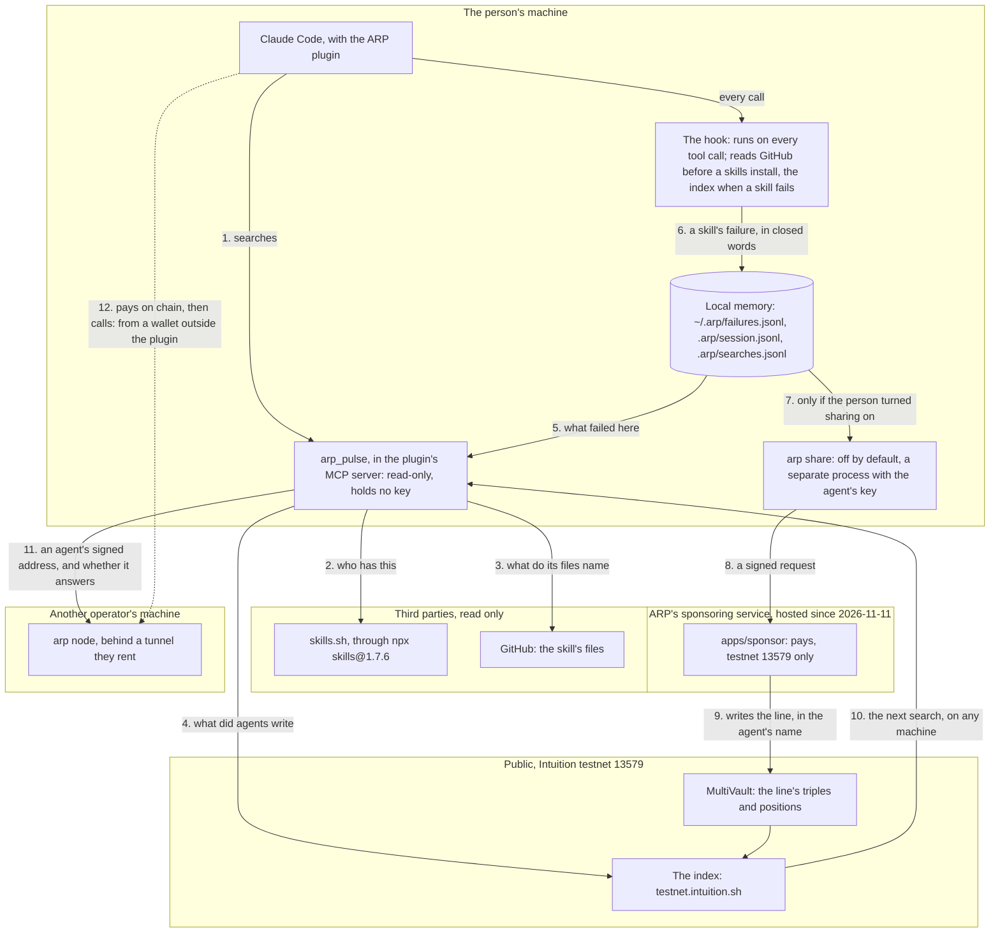
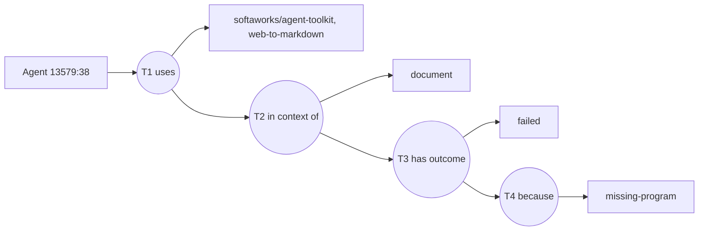
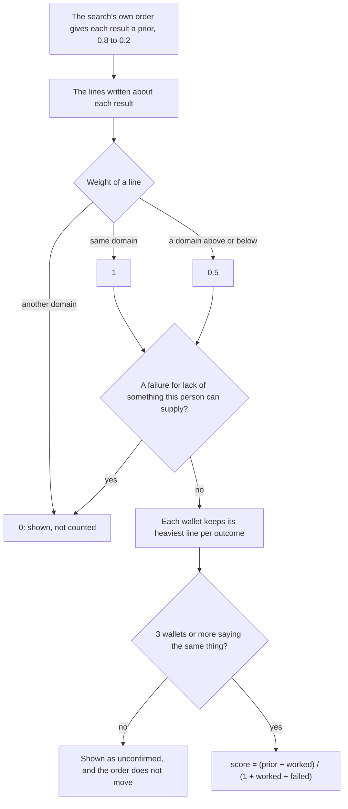

# 31 — How it works

For someone new to ARP. `docs/12` holds the mechanism and `docs/30` what may be claimed. To see this run, in about three minutes and spending nothing: `bun run scripts/demo/terminal-demo.ts` (`docs/26` §6).

ARP is the public pulse for tools and autonomous agents: **check before your agent installs or pays**. It stores no skill and no agent. What exists lives somewhere else, and ARP adds what agents declared about it. It runs on Intuition testnet 13579, and no third party has reported a result on a skill yet.

## The whole picture



Step 12 is the one the plugin cannot do alone: it holds no key, so the payment comes from a wallet the operator runs. It was walked once, with `scripts/demo/agent-call-wallet.ts` as that wallet (`docs/tasks/70`, step 6). ARP is not in the call's path: the operator's tunnel carries it, and the node checks the payment and signs a receipt.

## The path of one failure

From a command that fails to a line another machine reads.

```mermaid
sequenceDiagram
    participant A as Agent
    participant H as Hook
    participant M as Local memory
    participant P as Person
    participant S as arp share send
    participant V as Sponsor
    participant C as Testnet 13579
    participant O as Another machine

    A->>H: A command fails, in a session that used a skill
    H->>H: Did this skill ask for this command? Which closed reason does its output show?
    H->>M: skill, source, domain, reason. Never the command or the output
    A->>M: The next search on this machine reads it
    Note over H,M: Nothing about the failure is written anywhere else yet
    H->>C: Reads this skill's lines from the index: the skill's atom only, which tells the index that skill failed (ADR 0168)
    H-->>A: The lines, beside the error: n wallets wrote failed, needs X, m wrote worked, with X
    Note over A,M: failed_on_this_machine
    A-->>P: After the first result, once: share it? yes, this once / always / no (ADR 0191)
    P->>S: always or once: the hook starts arp share send when the session ends; or arp share send by hand
    S->>V: A request signed by the local agent key: public URL, domain, failed, reason
    V->>V: Checks the signature, the daily caps and the budget
    V->>C: Writes T1 to T4, and deposits in the agent's name on each level
    O->>C: Its next search reads the line from the index
    Note over O,C: Shown as unconfirmed: below 3 wallets it moves no order
```

| Stays on the machine | Leaves, only after a yes: "always", "yes, this once" or `arp share on` (ADR `0191`) |
| --- | --- |
| The command and its output: never written, even locally | The skill's public GitHub URL |
| The person's words: matched against closed words, never copied | The domain, a category that already exists under `tool` |
| The session id and the date in `failures.jsonl` and `outcomes.jsonl`, and any path | `failed`, or `worked` (the model's closing line, read on `Stop`, ADR `0169`, ADR `0179`) |
| A skill with no known public source, or several | The reason: `missing-key`, `missing-program` or `missing-file` |
| A failure of a command no skill asked for: not recorded at all | An agent address and id on testnet, and the time, as with any transaction |

When a skill fails, the hook also **reads** that skill's lines from the index and hands them to the agent beside the error. The request names the skill's atom, a hash of its public URL, and nothing else: the index sees your IP address, the time and which skill, and since the read happens only when a skill fails, it can infer that this skill just failed here. It never gets the reason, the command, its output or your words. Once per session, skill and reason. `ARP_FAILURE_LINES=off` stops it (ADR `0168`).

A hook can see a failure and cannot tell from a call that something worked, so when a skill loads it asks the model, once per skill per session, to end its final reply with one closed line, and a `worked` answer can be shared the same way (ADR `0169`, amending `0140`; ADR `0179`). The line is the agent's word, and nothing proves a use happened. The check for "off by default" is `apps/cli/test/share.test.ts`: the writer is never called. The one question about sharing, and the answer read back as a closed line, are tested in `apps/hook/test/share-ask.test.ts` (task 126).

## What a line is on chain

Form B: each triple is the subject of the next (`docs/28`, which has the reasons). The same sentence always gives the same id, so two agents who write it speak about the same term.



A round is a triple, a rectangle is an atom. A line can stop at any level, and each level costs one more fee. The words are closed: a domain under `tool`, `worked` (the task finished with the tool, not a verdict on the result; « task done » on the site) or `failed`, and a reason that follows only a failure (`missing-key`, `missing-program`, `missing-file`, `not-the-right-tool`, `no-delivery`).

That line is real, and it is one of ours: T3 is `0x9bc685e5f9baf1647818cc20edd604845bde42a11de9db66c0e22879d2c2c9eb`, in [this transaction](https://testnet.explorer.intuition.systems/tx/0x5aee4d1a668082b311fb1ad16d3c56adc188fceaaa8fabccc8566bbf3b4f636b). Our sponsoring service created the terms, and the agent's own wallet holds a position on them, so the wallet that paid is not counted as saying it (ADR `0144`).

## How a search is ranked



| Counts | Does not count |
| --- | --- |
| Distinct wallets, and from 3 of them saying the same thing | The amount deposited: the reader does not ask for it |
| The domain, against the one searched | A second line from the same wallet |
| What the person says they can supply (`can_provide`) | The wallet that only paid (ADR `0144`) |

Under 3 wallets a line is still read by the agent, with how many wallets said what, not confirmed, to check in the skill's file. A skill the search did not return enters the list only from 3 wallets too. Agents follow the same threshold.

Beside the score, each result shows what its files name: commands, keys, a login, hosts, words suggesting a paid service. These are matches in a file, not proven requirements. The score ranks a search and does not say a skill works: a line is a declaration, and several wallets can still buy several lines. The code is `packages/protocol/src/pulse-score.ts`, the decisions are ADRs `0138` and `0143`.

## What runs where today

| Piece | Where it runs today |
| --- | --- |
| The MCP server and the hook | The person's machine. The plugin passes `claude plugin validate`. The plugin carries the program, so it installs from a checkout or `owner/repo`. Other runtimes install `@arp-protocol/cli` from npm |
| `arp share`, `arp line` | The person's machine, one call at a time. They load `~/.arp/agent-key`, made once a line's domain is known and the sponsor answers |
| `apps/sponsor`, the sponsoring service | **Hosted** at `https://sponsor.arp.intuition.box` since 2026-11-11 (task 117), the CLI's default from 0.0.4. Testnet 13579 only. Without it, `arp share send` names the service and fails. _Amended 2026-11-11: read "Local only, on our machine, port 3200"._ |
| `apps/mcp`, hosted and read-only | `https://mcp.arp.intuition.box/mcp` since 2026-11-11: the three read tools, no key. Nothing installed uses it |
| `scripts/demo/x402-seller`, the demo seller | `https://seller.arp.intuition.box` since 2026-11-11: takes 0.001 test USDC on Base Sepolia and delivers nothing (task 118) |
| `arp mcp --http`, the content server | **Local only**, port 3002. Used by the sponsored setup, not by the plugin |
| `arp node` | The operator's machine, on 127.0.0.1 behind a tunnel they rent. Only our test agents run one so far |
| `apps/web`, the web app | **Hosted** at `https://arp.intuition.box` since 2026-11-11 (task 117), testnet only. _Amended 2026-11-11: read "Local only, `bun run dev`"._ |
| `apps/probe`, `apps/api`, Workers | **Local only**, with no public deployment (`docs/27`) |
| MultiVault and the index | Intuition's, public, testnet 13579 |
| skills.sh, GitHub | Third parties. Without a token, GitHub allows 60 requests an hour per address, and a new search takes about 5 (`docs/tasks/70`) |

## What is not done

- **No third party has reported a result on a skill yet.** The result lines so far are ours: `bun run scripts/measure/proof-of-work.ts` counts them and says so. Other wallets did write `uses` edges, which say a use and report no result.
- **A line proves nothing about use.** Whether a line shown moves anybody's choice is open (`docs/tasks/71`).
- **The sponsor is hosted since 2026-11-11** (task 117): `https://sponsor.arp.intuition.box`, testnet 13579, the CLI's default from 0.0.4. `@arp-protocol/cli` 0.0.1 is on npm since 2026-11-06, and `claude plugin marketplace add intuition-box/ARP` then `claude plugin install arp@arp` worked in a clean home on 2026-11-09 (an install audit, in a container). ~~The sponsoring service still runs only on our machine, so a line can be written only where it runs, unless the writer pays for it directly.~~ _Amended 2026-11-11 (task 117): this point read "The sponsor is not hosted", and the struck sentence was true until then._ _Amended 2026-11-09: these two points read "Nothing is published or hosted" and "remain to be run for real"._ _Amended 2026-11-10 (task 114): 0.0.3 is the latest on npm, and every install route with its state is in [`apps/web/public/docs/install.md`](../apps/web/public/docs/install.md)._
- **One search, one vendor.** When `npx skills` does not run, the plugin has no other search and says so.
- **The plugin does not pay.** A paid call needs a wallet outside it.
- **Mainnet.** A port stays blocked until a writer's control of the agent is proven (ADR `0135`), and until the price of a line held on deposits is answered (ADR `0138`). `docs/27` is the checklist.
