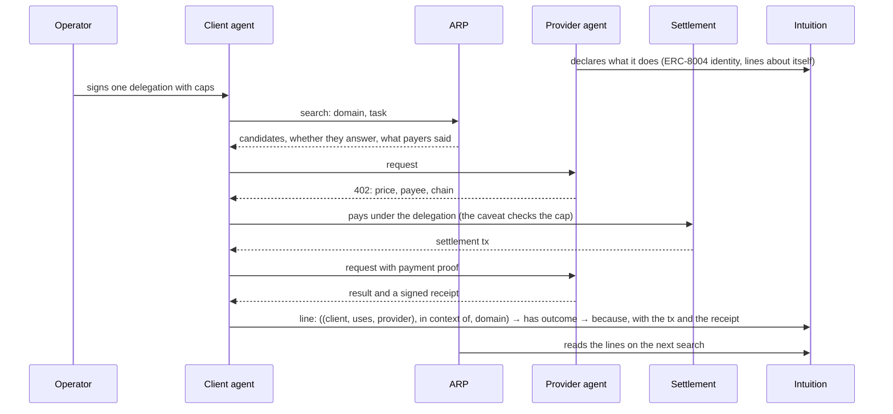

# 33 — The hire loop

**Status:** concept, not commitment; the five choices of §5 are decided (ADR `0148`). Written 2026-11-09 at the user's request (« créer le concept de
cette boucle… éviter de refaire quelque chose qui est déjà fait par tout le monde »). Nothing here is
built. It is the hire column of `docs/32`.

**What it answers:** which actors and which actions it takes for one agent to hire another for a
specialised task, how they pay each other, and which parts already exist elsewhere so ARP does not
rebuild them.

---

## 1. What already exists — reuse, do not rebuild

Read 2026-11-09, as web pages and specifications. None of this code was run.

| Piece | Who | What it does | What ARP takes from it |
| --- | --- | --- | --- |
| Identity and feedback | **ERC-8004** ([EIP](https://eips.ethereum.org/EIPS/eip-8004)) | An agent's identity (ERC-721), a thin Reputation Registry, a Validation Registry. Payments are out of scope, but the optional feedback file has `proofOfPayment {fromAddress, toAddress, chainId, txHash}`, "for x402 proof of payment" | The identity, already (ADR `0141`). The **`proofOfPayment` shape** for the proof attached to a hire line |
| "I accept payment" | ERC-8004 registration file | A boolean `x402Support` ([best practices](https://github.com/erc-8004/best-practices/blob/main/Registration.md)). It says a paywall exists, not which chain, token or price | Read it as a declared fact (tier 1). ARP's own registration files set it `false` (`packages/protocol/src/registration-file.ts:137`) |
| Payment over HTTP | **x402** | `402 Payment Required`, a signed payment, a facilitator that settles. An Offer & Receipt extension signs the seller's receipt | The payment. ARP's hire receipt v2 is already modelled on that extension (`packages/protocol/src/hire-receipt.ts:22`) |
| Finding paid services | **x402 Bazaar** ([docs](https://docs.x402.org/extensions/bazaar.md)) | A catalogue of x402 endpoints: an endpoint is catalogued when a facilitator processes a payment carrying the `bazaar` extension, possibly later. Any facilitator can run its own | Nothing to rebuild: ARP is not a catalogue of endpoints. It can read one as a source |
| Escrow and an evaluator | **ERC-8183** ([EIP](https://eips.ethereum.org/EIPS/eip-8183), "Agentic Commerce Protocol") | Draft. Client, provider, evaluator; funds in escrow until the evaluator accepts or rejects; a timeout refund; optional hooks, which forum proposals use to write an ERC-8004 signal on completion | If a task needs escrow, use 8183. ARP does not write an escrow contract. The EIP makes the evaluator trusted for completion and rejection, with no dispute resolution: its ruling is final |
| Bounded spending by an agent | **MetaMask Delegation Framework** | A delegation with caveats; `erc20TransferAmount`, `erc20PeriodTransfer` for tokens (`.claude/skills/mms-smart-accounts-kit/references/delegations.md:48,109`); a buyer-with-delegations guide for x402 (cited in `.claude/rules/metamask-delegation.md`, not read again here) | The guard rail. `TrustStakeCapEnforcer` only for native TRUST (ADR `0147`) |
| A check before paying | **Fizzl x402 Doctor** | Preflight `go`/`caution`/`no_go` for 0.001 USD, a daily Trust Index of about 40,800 services, outcome reports turning an endpoint `caution` after 3+ payers report failures (`FUTURE.md`, Fizzl section) | Do not rebuild a preflight. A checker like it could read ARP's records next to its own verdict |

**What nobody in this table does:** keep, across every buyer, a public and permanent record of how a
paid call went, **why it failed** in closed words, with **the payment checked when the record is read**,
readable by anyone who wants to rank or refuse. ERC-8004 feedback comes close: on chain a score, two tags,
an endpoint and a pointer; off chain, optional fields including `oasf.domains`, an A2A task id and
`proofOfPayment`. What it does not have is a closed set of failure reasons, and nothing checks the
payment when the feedback is read, so it stays free to write. A checker's outcome reports stay with that
checker. 8183's evaluator attests one job. That record, and the check, are ARP's part, and only that.

## 2. The actors

| Actor | What it is | What it does in the loop |
| --- | --- | --- |
| **Operator** | the person behind the client agent | signs one delegation, once, with its caps |
| **Client agent** | the agent that needs a task done | searches, checks, pays, declares the result |
| **Provider agent** | an ERC-8004 agent with an endpoint | declares what it does, answers, delivers, signs a receipt |
| **ARP** | an index and a reader | returns candidates with what others declared; computes the score; never relays the call, never holds the client's funds (`docs/12` point 6) |
| **Intuition** | the shared graph | holds the lines, in form B (`docs/28`) |
| **Settlement** | a chain and, for x402, a facilitator | moves the money; its transaction is the proof |
| **DelegationManager + caveat** | MetaMask's contract | refuses a payment over the cap before it moves |
| _Evaluator (optional)_ | an ERC-8183 evaluator | accepts or rejects the work when the task needs escrow |
| _Pre-pay checker (optional)_ | x402 Doctor or any other | says whether this payment is safe now |

## 3. The actions, in order

| # | Action | By | Exists today |
| --- | --- | --- | --- |
| 0 | Declare an identity, an endpoint, a price | provider | identity and signed endpoint yes (ADR `0141`); a price in an offer, partly (`docs/tasks/65`) |
| 1 | Sign a delegation with caps | operator | the framework yes; ARP's flow for it, set aside 2026-11-03, back for this column (ADR `0147`) |
| 2 | Find a provider for a domain | client via ARP | yes: `arp_find_agents`, `arp_agent_endpoints` (`answers_now`) |
| 3 | Check before paying | client | ARP shows declared lines; a preflight is Fizzl's, not ours |
| 4 | Pay | client under the delegation | native tTRUST to a node yes (`apps/node/src/task.ts`, `verifyPayment`); x402 **no**, deferred to mainnet (ADR `0102`) |
| 5 | Deliver and sign a receipt | provider's node | yes, hire receipt v2 (ADR `0098`, `0101`) |
| 6 | Declare the outcome, with the proof | client | the line yes (form B, `arp line`); the proof attached as a receipt yes (`agent-pulse.ts`); the settlement tx as one more level, `(outcome, paid with, eip155:<chain>/tx/<hash>)`, yes since task 89 (ADR `0159`), with the exact URL paid after it since task 93 (ADR `0162`), not in 8004's `proofOfPayment` shape |
| 7 | Read it on the next search | anyone | the score yes (`pulse-score.ts`); a dated feed for readers outside ARP, `/feeds/x402-outcomes.json`, yes since task 89, with no record yet and no reader wired (Fizzl offered) |

## 4. Where it sits on the ladder

| Tier | In the hire column |
| --- | --- |
| Declared | the line alone, `((client, uses, provider), in context of, domain)` and its outcome |
| Observed | the line carries the settlement tx, the payer — read from the token transfer — is the client agent's holder or its ERC-8004 `agentWallet`, and the provider's receipt is attached. A record tied to a real payment made by the agent that writes it is what a seller cannot flood with good records, nor a competitor with bad ones |
| Corroborated | 3+ distinct paying wallets, same outcome, same domain (ADR `0143-the-ranking-moves-from-three-wallets`) |

A record that names a payment it did not make stays at the declared tier: the check reads the token
transfer (never `tx.from`, which is the facilitator or the delegation's redeemer), and requires its payer
to be the client agent's holder or `agentWallet`, its recipient the provider's payee, its amount the offer's.

## 5. The five choices, decided 2026-11-09

The user's answers, ADR `0148`. Still a concept: nothing below is built.

| # | Question | Choice | Why |
| --- | --- | --- | --- |
| 1 | Pay first, or escrow? | **x402, paying first, by default. ERC-8183 escrow above a price or duration threshold.** ARP writes no escrow contract | every x402 seller already accepts the first; the second exists. An 8183 evaluator's attestation is shown as a dated fact with its source, never scored (ADR `0093`; `docs/12`'s drift signal against scoring other providers' assessments) |
| 2 | Pay on one chain, record on another | **No bridge, no oracle: the line carries the payment's reference, in ERC-8004's `proofOfPayment` shape (`chainId`, `txHash`, `fromAddress`, `toAddress`), and the reader checks it on the paying chain** — the payer is the client agent's holder or its `agentWallet`, the recipient the provider's payee, the amount the offer's. The payer is read from the token transfer itself (the `Transfer` event, or the EIP-3009 authorisation), never from `tx.from`, which is the x402 facilitator or the delegation's redeemer. The result is a dated fact, never on chain, as the probe is (ADR `0093`) | works for any chain; a line without a proof that checks stays declared |
| 3 | Delegation or a signature per call | **Both, by who is in charge.** An autonomous agent pays under a per-period delegation (`erc20PeriodTransfer` in USDC, `TrustStakeCapEnforcer` for native TRUST). With a person in the loop, or for a first run, x402's own per-payment signature | the seller receives an ordinary x402 payment either way; no ARP code in the payment |
| 4 | Mirror to ERC-8004 feedback | **Yes, observed lines only**: the client's agent also calls `giveFeedback`, with `proofOfPayment` and a URI pointing at the ARP line, which keeps the domain and the reason | puts the record where 8004's readers already look, with ARP as the source |
| 5 | An outside reader | **A dated, signed read API**, per endpoint and domain ("N payers, M failed, these reasons"), open to any reader. ARP also reads what others publish (a pre-pay checker's index under its licence, 8004 feedback, 8183 attestations) as dated facts, each with its source named | one record, readable by every checker or directory, instead of each keeping its own |

**How choice 2 links a smart account to the agent:** an agent that pays from a smart account under a
delegation pays from an address that is not the key writing the line. ERC-8004 already has the link: the
reserved `agentWallet`, set by `setAgentWallet` with an EIP-712 signature of the new wallet, ERC-1271
for a smart account, and reset when the agent changes hands (`contracts/src/erc8004/IdentityRegistry.sol:29,56,214`,
ARP's copy of the reference registry). The operator sets the smart account as the agent's `agentWallet`.
ARP's sponsor already accepts the holder or the `agentWallet` for a hire receipt
(`packages/protocol/src/sponsor/proof.ts:150-164`); choice 2 applies the same rule to the payer. Whether
the registry on the paying chain exposes `agentWallet` the same way is to check before building.

**What choice 4 costs:** one more write per hire, on the chain the registry is on, signed by the
client. Mirroring only observed lines keeps a free rating from carrying ARP's name.

## 6. What it would cost to build, roughly

Most of it is wiring what exists: the delegation flow (MetaMask), x402 on the node (task 41, deferred),
the tx in the line's proof (an 8004-shaped field), and the check of that tx when the line is read. No new
on-chain piece: escrow, if a task needs it, is 8183.
